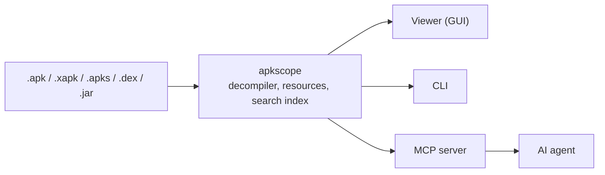

<div align="center">


# apkscope

**Open any Android app and see what it really does.**<br>
What it collects, how it makes money from you, what it exposes. In seconds, as readable Java.

[](https://github.com/suffixing/apkscope/actions/workflows/ci.yml)
[](https://github.com/suffixing/apkscope/releases)
[](LICENSE)
[](https://www.rust-lang.org)
[](#install)

[Install](#install) ·
[Overview](#overview) ·
[Findings](#what-it-found) ·
[Performance](#performance) ·
[Commands](#commands) ·
[Decompiler](#readable-java) ·
[MCP](#built-for-ai-agents) ·
[Viewer](#the-viewer) ·
[Library](#use-it-as-a-library) ·
[Limits](#honest-limits)

<br>


</div>

## Overview

apkscope is a single executable with no Java required. Drop in an APK and get a security overview,
readable Java, every endpoint and who calls it.

| Mode | Use it for | Start with |
|:--|:--|:--|
| **Viewer** | Browse a security overview, then the app's code | `apkscope gui app.apk` |
| **CLI** | Recon, cross-references, decompiling, patching, rebuilding | `apkscope scan app.apk` |
| **MCP server** | Let an AI agent drive the analysis | `apkscope mcp` |



**Highlights**

- **Typed Java, not pseudocode.** Output a reviewer, or an agent, can trust.
- **One tool instead of five.** Decompiler, xrefs, recon, diff, Frida, unpacking, re-signing, GUI and MCP.
- **Fast and light.** Opens TikTok 11x faster than JADX with 9x less RAM.
- **Edit and rebuild.** Patch Smali or resources, then rebuild and sign (v2 + v3).
- **Written from scratch in Rust.** Not a JADX fork, not a wrapper.

**Built for** security researchers, mobile pentesters, privacy researchers, developers checking what
a library really does, and anyone who hands APKs to an AI agent.

## What it found

Each finding below needed the manifest, the resources and the decompiled code read together. A grep
for `http://` finds none of it. Expand one for the proof: real output, trimmed to the lines that matter.

✅ safe on inspection &nbsp;·&nbsp; ℹ️ informational &nbsp;·&nbsp; ⚠️ real exposure

<details>
<summary>ℹ️ <b>1. Block Blast prices you for advertisers</b> · 13 ad networks, and its own model of what you're worth</summary>

<br>

Block Blast! 10.9.3 (Play build), 75,938 classes, scanned in 3.1 s.

**Who gets your data**

| Category | Found |
|:--|:--|
| Ad networks (13) | AppLovin MAX, AdMob, Meta, Unity, ironSource, Pangle, Liftoff/Vungle, InMobi, Moloco, Amazon APS, Digital Turbine/Fyber, PubMatic, Bigo |
| Trackers | AppsFlyer, Firebase, Facebook and TikTok events, ThinkingData, the studio's own `cn.hsdata` |
| Permissions | Advertising ID and all four Privacy Sandbox ad APIs |

**Two endpoints aren't from any SDK.** `infer` is a model call: what are this player's ads worth?

```text
$ apkscope search blockblast.xapk urls
q.mb("https://low-ecpm.afafb.com/infer/v1/low_ecpm_cut", appActivity, jSONObject, new c() {
return "https://ecpm.afafb.com/infer/v1/ecpm";

$ apkscope decompile blockblast.xapk me.f          # the code calls it AlgorithmInterCutManager
    m2.mg(jSONObject, "ActUserInfo", ClassE.ma());
    m2.me(jSONObject, "AdHistInfo", jSONArray);
    m2.mg(jSONObject, "UserContext", ClassE.mc(str2, appActivity, z, UUID.randomUUID().toString(), "INTER"));
    m2.mg(jSONObject, "UserInfo", ClassE.md());
```

Those fill in `deviceModel`, `ram`, `disk`, `cpu`, `carrier`, `country`, `ip_country`, `timeZone`,
`install_time`, `cold_start_num` and your past ads with their `revenue`. The answer sets your floor
price, the lowest bid an advertiser must beat to show you an ad:

```text
$ apkscope decompile blockblast.xapk v2.d --method Y        # AlgorithmBy1004, AppLovin MAX
    double d3 = d * d2;     // floor = predicted eCPM x "floor_factor" (remote, default 2.0)
    this.g_c.mi(d3);
        String.format(Locale.locale_US, "算法接口成功更新底价 - FloorPrice: %.2f, ...   // "algorithm API updated the floor price"
```

> [!NOTE]
> **Verdict:** legal, and how ad-funded games work. Now you can see it.

</details>

<details>
<summary>ℹ️ <b>2. Block Blast's server can switch the game into "audit mode"</b> · found in code the packer hid</summary>

<br>

Block Blast hides its game classes behind a NetEase packer: `org.cocos2dx.javascript.AppActivity` isn't
in the APK. `apkscope dump` let the game unpack itself and pulled 15 DEX out of memory in 25 s, about
3,100 hidden classes. The scripts call Java through `JsCallJava`; its methods show what they ask for:

```text
$ apkscope dump com.block.juggle out/ --attach
$ apkscope decompile out/dex/classes9.dex org.cocos2dx.javascript.pay.o --method w   # SPayManager.serverControl
    if (jSONObject.has("isStatus")) {
        boolean z = k0.ma("1", jSONObject.getString("isStatus"));
        SPStore.mk().y(z);
        JsCallJava.setGameAuditMode(z, "auditMode");      // → window.IPAUtils.respHearingState(1)
```

| What | Detail |
|:--|:--|
| **A server switch** | The payment manager's server reply turns `auditMode` on in the game's scripts, and the game remembers it. Games use this to act differently while a store reviews them. What Block Blast changes is in its encrypted scripts, so we don't claim more. |
| **Your phone, on request** | `callNativeGetLeftBattery` (battery %), `callNativeIsInstallOtherApp` (is app X installed?), `getDeviceInfoByAdb` (CPU speeds, RAM, storage, screen, model) |
| **Revenue per round** | `trackGameEndRevenue` stores revenue data at the end of each game |
| **Bluetooth is benign** | `BleBumpKit` pairs two phones nearby, after asking permission |

> [!NOTE]
> Not shown: how it decides your next blocks. That's in the encrypted scripts (see [limits](#honest-limits)).

</details>

<details>
<summary>⚠️ <b>3. Nextcloud lets any app on the phone read and edit your file index</b></summary>

<br>

The file-database provider is exported, and its `<path-permission>` tags name a permission literally
called `"false"`. The only real guard is in code, and it skips `file/`, `dir/` and the root:

```text
$ apkscope decompile nextcloud.apk com.owncloud.android.providers.FileContentProvider
    private boolean isCallerNotAllowed(Uri uri) {
        switch (i) {
            case 4: case 5: case 6: case 7: case 8:     // shares, capabilities, uploads, ...
                str = this.mContext.getPackageManager().getNameForUid(Binder.getCallingUid());
        }
        return false;                                   // file (1), dir (2), root (3): anyone
    }
    public Cursor query(Uri uri, ...) {
        if (i != 1 && i != 2 && i != 3 && isCallerNotAllowed(uri)) {
```

(Case labels folded, comments added.) `insert`, `update` and `delete` use the same check. The table
holds `path`, `path_decrypted`, `file_owner`, `sharees`, `share_by_link`, `metadata_gps`...

> [!WARNING]
> **Verdict:** any installed app can read your file names, folders and shares, decrypted names of
> end-to-end-encrypted files included, and change or delete rows.
> [GitHub Security Lab noted it in 2021](https://securitylab.github.com/advisories/GHSL-2021-1007-Nextcloud_Android_app/);
> the SQL injection from that report was fixed, the open access is still there in 35.0.1.
> Read from code, not run on a device.

</details>

<details>
<summary>ℹ️ <b>4. AntennaPod trusts certificates the user installed</b></summary>

<br>

```text
$ apkscope resource antennapod.apk res/xml/network_security_config.xml
    <base-config cleartextTrafficPermitted="true">
        <trust-anchors>
            <certificates src="user" />
            <certificates src="system" />

$ apkscope decompile antennapod.apk de.danoeh.antennapod.net.ssl.CompositeX509TrustManager --method checkServerTrusted
        X509TrustManager x509TrustManager = (X509TrustManager) iterator.next();
        try {
            x509TrustManager.checkServerTrusted(x509CertificateArr, str);
```

> [!NOTE]
> **Verdict:** since Android 7 apps ignore user certificates; this one opts back in, so a managed
> device or a "VPN" app that installs one can read its HTTPS. The custom TrustManager tries each real
> one and throws if none accepts: a deliberate choice, not the trust-everything bug.

</details>

<details>
<summary>✅ <b>5. Thunderbird ships a debug activity any app can launch</b> · checked: safe on release</summary>

<br>

`scan` lists Jetpack Compose's `PreviewActivity` as exported. It runs any class named in the intent.

```text
$ apkscope decompile thunderbird.apk androidx.compose.ui.tooling.PreviewActivity --method onCreate
        int i = getApplicationInfo().flags & 2;
        if (i == 0) {
            Log.md(str, "Application is not debuggable. Compose Preview not allowed.");
            finish();
```

> [!TIP]
> **Verdict:** `flags & 2` is `FLAG_DEBUGGABLE`, and release builds aren't. Every scanner flags this;
> only the code says it's safe, until someone ships a debuggable build.

</details>

<details>
<summary>✅ <b>6. KeePassDX "uses AES in ECB mode"</b> · checked: correct</summary>

<br>

```text
$ apkscope decompile keepassdx.apk com.kunzisoft.encrypt.aes.AESTransformer
            cipher = Cipher.getInstance("AES/ECB/NoPadding");
            key = (Key) new SecretKeySpec(bArr, "AES");
            cipher.init(1, key);
                while (UnsignedKt.ulongCompare(j2, j) < 0) {
```

> [!TIP]
> **Verdict:** the KeePass AES-KDF encrypts one block with itself `rounds` times to slow down password
> guessing. ECB on one block is the spec. Knowing which flags to drop is half the job.

</details>

## Performance

<div align="center">
  
</div>

| Benchmark | Result | Detail |
|:--|:--|:--|
| Open TikTok vs JADX | **11x faster, 9x less RAM** | 12.4 s / 997 MB vs 2 min 18 s / 9.4 GB |
| Decompile one class vs rust_ASC | **Up to 1.8x faster** | Faster on 8 of 10 popular apps, level on 2, and output is Java |
| Decode the manifest vs rust_ASC | **1.2-3x faster** | All 10 apps, using 10-138 MB instead of 26-493 MB |
| Memory vs rust_ASC | **Lower** | On 59 of 70 cold queries |
| Per agent call over MCP vs rust_ASC | **2.7x faster** | 70 ms vs 191 ms median |
| 39 agent calls on TikTok | **3.94 s** | vs rust_ASC's 6.54 s |

Every number comes from a script in [`bench/`](bench). See [all results](BENCHMARKS.md), and the
[honest limits](#honest-limits) for where rust_ASC is still quicker.

## Install

### Quick install

**Linux (x86_64, aarch64) and macOS.** One command; it detects your CPU and verifies the checksum.

```bash
curl -fsSL https://raw.githubusercontent.com/suffixing/apkscope/main/scripts/install.sh | sh

# or a pinned version
curl -fsSL https://raw.githubusercontent.com/suffixing/apkscope/main/scripts/install.sh | sh -s 0.9.1
```

**Windows (PowerShell)**

```powershell
irm https://raw.githubusercontent.com/suffixing/apkscope/main/scripts/install.ps1 | iex
```

To uninstall, run `scripts/uninstall.sh` (Linux/macOS) or `scripts/uninstall.ps1` (Windows).

### Prebuilt binaries

Grab a binary straight from [Releases](https://github.com/suffixing/apkscope/releases).

| Binary | Platform | Viewer | CLI | MCP | Notes |
|:--|:--|:-:|:-:|:-:|:--|
| `apkscope_windows_x86_64.exe` | Windows x86_64 | ✅ | ✅ | ✅ | |
| `apkscope_linux_x86_64`<br>`apkscope_linux_aarch64` | Linux (glibc) | ✅ | ✅ | ✅ | Built on Ubuntu 24.04, needs glibc 2.39+ |
| `apkscope_<version>_<arch>.deb`<br>`apkscope-<version>-<arch>.AppImage` | Debian/Ubuntu, any distro | ✅ | ✅ | ✅ | Same glibc 2.39+ requirement |
| `apkscope_linux_musl_x86_64`<br>`apkscope_linux_musl_aarch64` | Linux (static) | ❌ | ✅ | ✅ | For servers, containers and Alpine. Runs on any glibc distro too |
| `apkscope_macos_*` | macOS | 🔨 | ✅ | ✅ | Build the viewer from source |

> [!NOTE]
> The static musl binary has no viewer, and can't have one: a fully static binary cannot load the
> desktop's X11/Wayland/GL libraries. Ask it for the GUI and it says exactly that.

### Build from source

```bash
cargo build --release                          # viewer + CLI + MCP server
cargo build --release --no-default-features    # CLI + MCP only (servers)
```

The viewer needs no system GUI libraries at build time. It loads the desktop's X11 or Wayland stack
(and xdg-desktop-portal for file dialogs) at runtime, so the same binary runs on any distro with a
new-enough glibc.

### Quick start

```bash
# 1. Open the viewer
apkscope gui app.apk

# 2. Or run a scan from the CLI
apkscope scan app.apk

# 3. Or give it to your AI agent (any MCP client works)
claude mcp add apkscope -- /path/to/apkscope mcp
```

<details>
<summary>MCP client configuration (JSON)</summary>

```json
{
  "mcpServers": {
    "apkscope": {
      "command": "/path/to/apkscope",
      "args": ["mcp"]
    }
  }
}
```

</details>

## Commands

Run `apkscope --help` for the full list.

> [!TIP]
> `--json`, `--limit N` and `--offset N` work on every command. Inputs can be `.apk`, `.jar`
> (Android framework JARs), `.apks`, `.xapk` or `.dex`.

### Recon

| Command | What it does |
|:--|:--|
| `apkscope scan app.apk` | Flags, exported components, weak crypto, TLS, keys, URLs |
| `apkscope info app.apk` | Permissions, components, deep links, signature |
| `apkscope search app.apk urls` | Every endpoint (also: `secrets`, `http`, `code`, `res`) |
| `apkscope diff old.apk new.apk --strings` | What changed in this update |

### Follow the code

| Command | What it does |
|:--|:--|
| `apkscope refs app.apk string X-Goog-Api-Key --java` | Who uses it, with the Java line |
| `apkscope decompile app.apk com.example.Api --method login` | One method, as Java |
| `apkscope callers app.apk com.example.Api login` | Every caller (`callgraph` gives the tree) |
| `apkscope access app.apk com.example.Session token` | Who reads and writes a field |
| `apkscope decrypt app.apk` | Run string decryptors on their constant args |

### Go further

| Command | What it does |
|:--|:--|
| `apkscope dump app.apk out/ --attach` | Packed app: save the DEX it unpacked in memory |
| `apkscope il2cpp game.xapk --uses "https://"` | Unity games: which C# method uses a string |
| `apkscope frida app.apk com.example.Api login` | Ready-to-run hook (args, return, throws) |
| `apkscope rename app.apk "com.a.b#c()" login` | Names and comments, kept across runs |
| `apkscope export app.apk out/` | Gradle project for Android Studio |

### Patch and rebuild

| Command | What it does |
|:--|:--|
| `apkscope smali app.apk com.example.Api > Api.smali` | One class as editable Smali |
| `apkscope build app.apk out.apk --smali Api.smali` | Assemble it back in, rebuild, sign |
| `apkscope res app.apk app/` | Manifest and `res/` as editable files |
| `apkscope build app.apk out.apk --res app/` | Put back what changed, rebuild, sign |
| `apkscope build app.apk out.apk --string "app_name=My App"` | Edit a string, rebuild, sign (v2 + v3) |

<details>
<summary><b>Resource editing in detail</b></summary>

<br>

`apkscope res` writes `AndroidManifest.xml` and `res/` as apktool lays them out:

- Values become `res/values*/*.xml`, with a `public.xml` that keeps every resource's ID.
- Layouts, drawables and other XML become text. Everything else is written as it is.

`build --res` puts back only the files that changed, so whatever you don't touch stays exactly as it was.

| You can | How it works |
|:--|:--|
| Change a string or layout attribute | Edit the text file |
| Add a value | Use the ID `public.xml` gives it, or the next free one |
| Delete a value or a whole `values-xx/` directory | Remove it from the files |
| Add new files under `res/` | Their resources are added, with XML compiled as aapt2 would (a layout can use a string added with it) |
| Delete files | They are removed |

A new directory gets the configuration aapt2 would give it for the app's `minSdkVersion`.

> [!NOTE]
> Images aren't processed, so a new `.9.png` must already be compiled, as one taken from another
> APK is. Renaming resources isn't supported yet.

</details>

<details>
<summary><b>How <code>decrypt</code> and <code>dump</code> work</b></summary>

<br>

- **`decrypt`** runs the app's own decryptor in a sandboxed Dalvik interpreter (no I/O, no
  reflection, step-limited) and shows the result inline: `a.b("x#9!") /* = "https://api.example.com" */`.
- **`dump`** lets the app unpack itself under Frida, then pulls every DEX out of its memory,
  skipping the ones already on disk. It also hooks native `evalString` to save scripts after the
  engine decrypted them. Needs a rooted device with frida-server.

</details>

## Readable Java

<table>
<tr><th width="50%">rust_ASC</th><th width="50%">apkscope</th></tr>
<tr><td>

```java
Throwable v3_5 = ((java.net.HttpURLConnection)
    ((com.google.android.datatransport.cct
      .CctTransportBackend$HttpRequest) p17)
    .a.openConnection());
v3_5.setDoOutput(1);
v3_5.setInstanceFollowRedirects(0);
java.io.InputStreamReader v5_4 = new Object[1];
```

</td><td>

```java
HttpURLConnection httpURLConnection =
    (HttpURLConnection) httpRequest.a.openConnection();

httpURLConnection.setDoOutput(true);
httpURLConnection.setInstanceFollowRedirects(false);
Object[] objArr2 = new Object[1];
```

</td></tr>
</table>

| Supported | Notes |
|:--|:--|
| Control flow | Loops, `switch`, `try`/`catch`/`finally` |
| Language features | Lambdas, enums, typed names |
| Deobfuscation | `a.b` becomes `pkg_a.RunnableB` |
| Speed | Faster than rust_ASC per class on 8 of 10 popular apps, level on the other 2 |
| Safety net | Uncertain methods get a `/* WARNING */` header; failures fall back to Smali, never silently |

## Built for AI agents

Add apkscope as an MCP server and your agent can explore an APK with typed, paged tool calls.

| MCP tool | What the agent gets |
|:--|:--|
| `find_refs` | Who uses a string, type, method or field, or implements an interface, with Java lines |
| `decompile` | Java or Smali of several classes, or one method |
| `search` | Code, strings, usages, classes, resources, URLs, HTTP calls, secrets |
| `apk_info`<br>`get_manifest`<br>`diff_apks` | Permissions, components, deep links, risky flags, what changed |
| `list_classes`<br>`list_methods`<br>`list_strings` | Listings with prefix, filter and app-only |
| `get_resource`<br>`export_project`<br>`verify_signature` | Resources, Gradle export, signatures |
| `frida_start`<br>`frida_hook`<br>`frida_events`<br>`frida_script` | Live Frida: hook by name, read calls, args and returns |
| `callers`<br>`call_graph`<br>`field_access` | Who calls a method, the callee tree, where a field is read and written |
| `decrypt_strings`<br>`scan` | Recovered string-decryptor plaintext; one-shot URL, secret and HTTP scan |

Replies page with `limit` / `offset` and cap at 60k characters. `app_only` hides androidx, Play
services and ad SDKs.

**Try asking:**

> *Can this app's HTTPS traffic be intercepted?*

The agent finds [finding 4](#what-it-found) on its own, in under half a second of tool time.

## The viewer

Double-click `apkscope.exe` (or run the Linux binary, `.deb` or AppImage) and drop in an APK. You get
the security overview first, then your app's code apart from the libraries.

| Action | Result |
|:--|:--|
| **Click** a name | Mark it |
| **Ctrl + click** a name | Jump to it |
| **Right-click** a name | Callers, call graph, field access, Frida hook, Smali, rename |
| Click a search result | Jump to the exact line |
| **Edit smali** on a class | Patch its code, then **Build & sign** (with undo) |

## Use it as a library

The editing half is its own crate, **`apkscope-core`** (in [`core/`](core)), for tools that patch APKs
themselves: the DEX reader and writer, the Smali round trip, resources, rebuild and signing, without
the decompiler, the command line or the viewer.

```toml
[dependencies]
apkscope-core = { git = "https://github.com/suffixing/apkscope" }
```

```rust
use apkscope_core::{apksign, rebuild, smali};

let class = smali::export_class("app.apk", "com.example.Api")?;
let mut edits = rebuild::Edits::new();
smali::inject("app.apk", &[class.replace("const/4 v0, 0x0", "const/4 v0, 0x1")], &mut edits)?;
let (apk, central_dir) = rebuild::rebuild("app.apk", &edits)?;
let key = apksign::load("key.pk8".as_ref(), "cert.crt".as_ref())?;
std::fs::write("out.apk", apksign::sign(apk, central_dir, &key)?)?;
```

> [!IMPORTANT]
> Nothing is signed unless you call `sign`.

<details>
<summary><b>More examples: in-memory APKs and resources</b></summary>

<br>

The same works on an APK that is already in memory, or anything else that reads and seeks.
`apk::Apk::new(reader)` opens it once, `smali::export_class_from` and `smali::inject_into` work on
the open APK, and `rebuild::rebuild_from` takes the reader.

```rust
use apkscope_core::{apk::Apk, rebuild, smali};
use std::io::Cursor;

let mut apk = Apk::new(Cursor::new(&bytes))?;
let class = smali::export_class_from(&mut apk, "com.example.Api")?;
let mut edits = rebuild::Edits::new();
smali::inject_into(&mut apk, &[class.replace("const/4 v0, 0x0", "const/4 v0, 0x1")], &mut edits)?;
let (unsigned, _) = rebuild::rebuild_from(Cursor::new(&bytes), &edits)?;
```

Resources are files you edit as text, the same as `apkscope res` writes them:

```rust
use apkscope_core::{apk::Apk, rebuild, resources};

let mut apk = Apk::new(std::fs::File::open("app.apk")?)?;
let mut files = resources::decode(&mut apk)?;     // "res/values/strings.xml" -> bytes, ...
let strings = String::from_utf8(files["res/values/strings.xml"].clone())?;
files.insert("res/values/strings.xml".into(), strings.replace(">Old<", ">New<").into_bytes());
let edits = resources::edits(&mut apk, &files, false)?;  // only resources.arsc changes
let (unsigned, _) = rebuild::rebuild("app.apk", &edits)?;
```

</details>

<details>
<summary><b>Lower-level modules and error types</b></summary>

<br>

Underneath the resource API are three modules. Each writes back what it read byte for byte.

| Module | What it gives you |
|:--|:--|
| `table` | `resources.arsc` as a model you can change: `find`, `set`, `add`, `remove` |
| `values` | Values XML into a table |
| `xml` | Binary XML as a model, and edited text back into it |

Fallible functions return `apkscope_core::Error`, a `thiserror` enum:

| Variant | Meaning |
|:--|:--|
| `Io`, `Zip`, `Key`, `Rsa` | Keep the underlying error as their `source()` |
| `In` | Says which file or entry an error is in |
| `ClassNotFound`, `EntryNotFound` | Name what's missing |
| `Smali` | Carries the line |
| `Dex`, `Assemble`, `Resources`, `Xml`, `Signature` | Describe what is wrong with that kind of input |

`Error::report()` joins a message with its causes, which is what the command prints.

</details>

## Honest limits

> [!NOTE]
> Scans are heuristics, and findings are leads, not verdicts (see [finding 6](#what-it-found)).

| Area | Limitation |
|:--|:--|
| **Decompiler** | Some complex methods still use `goto` labels (marked `WARNING`). |
| **Cold queries** | rust_ASC is still quicker at string xrefs (0.78-0.97x, 5-40 ms) and a little quicker on most ~50 ms listings. In agent sessions apkscope is faster. |
| **Memory** | Huge apps take about 1 GB in the viewer. The first full-code search takes a minute, then it's cached. |
| **Viewer** | Tested on Windows and Linux (Ubuntu, including WSLg). The static musl binary has no viewer. |
| **`decrypt`** | Only runs decryptors that compute from constants. |
| **`dump`** | Needs a rooted device. Some protectors crash when Frida spawns the app: start it normally and use `--attach`. Script capture needs an engine that exports `evalString`, and isn't verified on a real game yet (an x86 emulator can't hook ARM-only engines). |
| **`il2cpp`** | Reads arm64 builds and was checked on metadata v39 (Unity 6); older versions may misparse. |
| **Callers, call graphs, Frida hooks** | See direct calls only, not reflection, JNI or dynamic code. |

## About

**Written from scratch.** DEX parser, decompiler, deobfuscator, resource decoder, search index, APK
signer, MCP server and viewer: all Rust, from zero. Not a JADX fork, not a wrapper.

**Found wrong output?** Open an issue with the class name and what JADX shows.

**License.** [Apache 2.0](LICENSE). "apkscope" and its logo are trademarks of Ahmad, see
[NOTICE](NOTICE). `src/data/android_public.txt` comes from AOSP (Apache 2.0).
