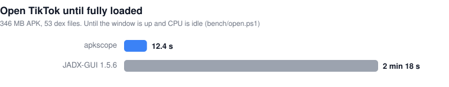

<p align="center"></p>

<h1 align="center">apkscope</h1>

<p align="center">
  <b>Ask an APK anything. Get real Java back in milliseconds.</b><br>
  Android reverse engineering for humans and AI agents. One executable. No JVM. No waiting.
</p>

<p align="center">
  <a href="#get-started-in-30-seconds"></a>
  <a href="BENCHMARKS.md"></a>
  <a href="BENCHMARKS.md#features-apkscope-vs-rust_asc-vs-jadx"></a>
</p>

<p align="center">
  
</p>

| | |
|---|---|
| **11x faster** than JADX to open TikTok, with **9x less RAM** | 12.4 s / 997 MB vs 2 min 18 s / 9.4 GB |
| **2.7x faster** than rust_ASC per agent call | 70 ms vs 191 ms median, over MCP |
| **Typed Java**, not pseudocode | a reviewer, or an agent, can trust it |
| **One tool**: decompiler, xrefs, API recon, diff, re-signing, GUI, MCP | instead of five |

Every number comes from a script in [`bench/`](bench). [See all results →](BENCHMARKS.md)

---

## One question, one call

*"Where does this app send its API key?"*

```text
$ apkscope refs app.apk string X-Goog-Api-Key --java
classes.dex | Lcom/google/android/datatransport/cct/a;->a(Ljava/lang/Object;)Ljava/lang/Object; | matched=X-Goog-Api-Key
       65: httpURLConnection.setRequestProperty("X-Goog-Api-Key", str2);
1 refs in 53 ms
```

The string, the exact method and the Java line. 53 ms from a cold start, no index to build.

## Get started in 30 seconds

**1. Get it:** download `apkscope.exe` from [Releases](https://github.com/suffixing/apkscope/releases), or build it:

```bash
cargo build --release                          # viewer + CLI + MCP server
cargo build --release --no-default-features    # CLI + MCP only (Linux, macOS, servers)
```

**2. Give it to your agent:**

```bash
claude mcp add apkscope -- /path/to/apkscope mcp
```

Works with any MCP client (Claude Desktop, Cursor, Windsurf, Codex):
`{ "mcpServers": { "apkscope": { "command": "/path/to/apkscope", "args": ["mcp"] } } }`

**3. Or just use it:** `apkscope gui app.apk`, or any command below.

## Java you can actually read

The same Google networking code, decompiled by rust_ASC and by apkscope:

<table><tr><th>rust_ASC</th><th>apkscope</th></tr><tr><td>

```java
Throwable v3_5 = ((java.net.HttpURLConnection)
    ((com.google.android.datatransport.cct
      .CctTransportBackend$HttpRequest) p17)
    .a.openConnection());
v3_5.setDoOutput(1);
v3_5.setInstanceFollowRedirects(0);
java.io.InputStreamReader v5_4 = new Object[1];
```

</td><td>

```java
HttpURLConnection httpURLConnection =
    (HttpURLConnection) httpRequest.a.openConnection();

httpURLConnection.setDoOutput(true);
httpURLConnection.setInstanceFollowRedirects(false);
Object[] objArr2 = new Object[1];
```

</td></tr></table>

Left: a connection typed `Throwable`, booleans as `1`/`0`, an array typed `InputStreamReader`.
Right: code you can reason about. And it's faster too: apkscope decompiles one class quicker than
rust_ASC on 9 of 14 apps tested.

Loops, `switch`, `try`/`catch`/`finally`, lambdas, enums, typed and named variables, and
deobfuscation (`a.b` becomes `pkg_a.RunnableB`) are all handled. Nothing fails silently: uncertain
methods get a `/* WARNING */` header, and the rare failure falls back to Smali.

## What you can do

```bash
apkscope refs app.apk string "https://" --java              # who uses it, with the Java lines
apkscope refs app.apk impl javax.net.ssl.X509TrustManager   # custom TLS trust = pinning bypass spots
apkscope decompile app.apk com.example.Api --method login   # one method, as Java
apkscope diff old.apk new.apk --strings                     # what changed in this update
apkscope search app.apk secrets --app-only                  # keys, tokens, JWTs, also in .so files
apkscope search app.apk urls                                # every endpoint
apkscope info app.apk                                       # exported components, risky flags, permissions
apkscope export app.apk out/                                # Gradle project for Android Studio
apkscope build app.apk out.apk --string "app_name=My App"   # edit, rebuild, sign (v2 + v3)
```

Add `--json`, `--limit N` or `--offset N` to any of them. Takes `.apk`, `.apks`, `.xapk` and `.dex`.
`apkscope --help` lists every command. rust_ASC's command names (`findrefs`, `getclass`...)
work too.

**New in 0.4: `diff`.** Compare two versions of an app and see the classes, methods, permissions and
strings that were added or removed. New endpoints and keys stand out right away.

## Built for AI agents

| MCP tool | What the agent gets |
|---|---|
| `find_refs` | who uses a string, type, method or field, or subclasses an interface; with Java lines |
| `decompile` | Java or Smali of several classes, or one method |
| `search` | code, strings, usages, classes, resources, URLs, HTTP calls, secrets |
| `apk_info` / `get_manifest` | permissions, exported components, deep links, risky flags |
| `diff_apks` | what changed between two versions |
| `list_classes` / `list_methods` / `list_strings` | with prefix, filter and app-only |
| `get_resource` / `export_project` / `verify_signature` | resources, Gradle export, signatures |

**It saves the agent's context.** Every reply pages with `limit` / `offset`, is capped at 60k
characters by default, and `app_only` hides androidx, Play services and ad SDKs.

**It gets faster as the agent works.** The first call reads only what it needs while the app loads
in the background. On TikTok, 39 agent calls took **3.94 s** vs rust_ASC's **6.54 s**.

## The viewer

Double-click `apkscope.exe` and drop in an APK. You get a security overview first (permissions,
exported components, risky flags, signature), your app's code apart from the libraries, search
built for API work, native library reports with JNI methods decoded, and **Edit → Build & sign**
with undo.

## Honest limits

- Some complex methods still use `goto` labels (they're marked with a `WARNING`).
- On a cold one-shot query rust_ASC is still a few ms quicker on many apps, and 1.8x quicker at
  listing TikTok's 436k classes. In agent sessions apkscope is faster.
- Opening huge apps in the viewer takes about 1 GB (TikTok). The first full-code search takes a minute; later ones are cached.
- The viewer is tested on Windows. The CLI and MCP server pass CI on Linux and macOS.
- Secret and URL scans are heuristics: runtime-built or encrypted strings won't show up.

## Written from scratch

DEX parser, bytecode decoder, decompiler, deobfuscator, resource decoder, search index, APK signer,
MCP server and viewer: all Rust, all from zero. Not a JADX fork, not a wrapper.

Found wrong output? Open an issue with the class name and what JADX shows. MIT licensed, see
[LICENSE](LICENSE). `src/data/android_public.txt` comes from AOSP (Apache 2.0).
